  

  <a href="https://www.linkedin.com/in/aryanlodha26/">LinkedIn</a>

---

### About

I'm an Industrial Engineering and Management student at RV College of Engineering, Bengaluru. I like building useful software, figuring out how systems work, and bringing ideas to life with a little hardware.

### Focus

- AI tools and practical web applications
- Optimisation, logistics, and smarter systems
- Arduino, sensors, and hands-on prototypes

### Tech

`Python` · `TypeScript` · `C++` · `Arduino`
